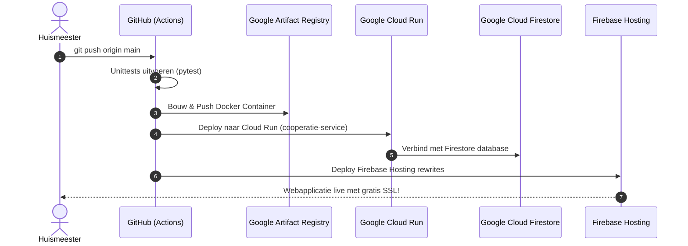

# Handleiding: Deployment naar Google Cloud & Firebase

Deze handleiding legt stap voor stap uit hoe je de **Huismeester Contactmanager** live zet op **Google Cloud Run** en **Firebase Hosting** met automatische uitrol via **GitHub Actions**.

---

## Overzicht van de Pipeline



---

## Stap 1: Jouw GitHub Repository koppelen

Als je nog geen GitHub repository hebt aangemaakt:
1. Ga naar [GitHub.com/new](https://github.com/new) en maak een nieuwe repository aan (bijv. `contact-manager`).
2. Koppel jouw lokale repository en push de code:
   ```bash
   git remote add origin https://github.com/JOUW-GEBRUIKERSNAAM/contact-manager.git
   git branch -M main
   git push -u origin main
   ```

---

## Stap 2: Google Cloud Project inrichten (via Google Cloud Shell)

De snelste en makkelijkste manier is via **Google Cloud Shell** in je browser (daar is `gcloud` al ingelogd):

1. Ga in je browser naar: [https://shell.cloud.google.com](https://shell.cloud.google.com)
2. Zorg dat je project geselecteerd is:
   ```bash
   gcloud config set project JOUW-GOOGLE-CLOUD-PROJECT-ID
   ```
3. Voer het klaargezette setup-script uit:
   ```bash
   curl -sSL https://raw.githubusercontent.com/JOUW-GEBRUIKERSNAAM/contact-manager/main/scripts/setup_gcp.sh | bash
   ```
   *(Of kopieer en plak de inhoud van `scripts/setup_gcp.sh` in de Cloud Shell)*.

Dit script doet automatisch het volgende:
* Schakelt Cloud Run, Firestore, Artifact Registry en Firebase APIs in.
* Maakt de Docker repository `contact-manager` aan in regio `europe-west4` (Nederland).
* Maakt de Firestore database in Native mode aan.
* Maakt een Service Account `github-deployer` aan met de benodigde uitrolrechten.
* Genereert het bestand `github-actions-sa-key.json`.

---

## Stap 3: Twee Secrets toevoegen in GitHub

1. Ga in jouw GitHub repository naar **Settings** -> **Secrets and variables** -> **Actions**.
2. Klik op **New repository secret**:
   * **Secret 1:**
     * Naam: `GCP_PROJECT_ID`
     * Waarde: Het ID van jouw Google Cloud project (bijv. `vve-complex-beheer-12345`).
   * **Secret 2:**
     * Naam: `GCP_SA_KEY`
     * Waarde: De volledige inhoud van het bestand `github-actions-sa-key.json` dat door het setup-script is gegenereerd.

*(Optioneel voor Firebase Hosting custom domains)*:
* **Secret 3:** `FIREBASE_TOKEN` (via `firebase login:ci`). Als je dit nog niet hebt ingesteld, draait Cloud Run nog steeds direct live via de veilige `*.run.app` HTTPS URL!

---

## Stap 4: Automatische Uitrol (Livegang)

Zodra de secrets zijn toegevoegd:
* Elke commit die je naar de `main` branch pusht, start automatisch de GitHub Actions workflow ([deploy.yml](file:///home/alberdao/ai_projecten/contact_manager/.github/workflows/deploy.yml)).
* De tests worden gedraaid, de container wordt gebouwd en uitgerold naar **Google Cloud Run**.
* In het GitHub Actions logboek zie je direct de live HTTPS-link naar jouw draaiende applicatie!

---

## Kostenbeheersing & Veiligheid

* **Schaalt naar 0:** Als niemand de website gebruikt, staan er 0 containers aan (min-instances=0). Hierdoor vallen de kosten binnen de royale maandelijkse gratis bundels van Google Cloud.
* **Geen vaste servers:** Cloud Firestore en Cloud Run zijn 100% serverless.
* **Dependabot:** Scant wekelijks automatisch of er updates nodig zijn om kwetsbaarheden te voorkomen.
